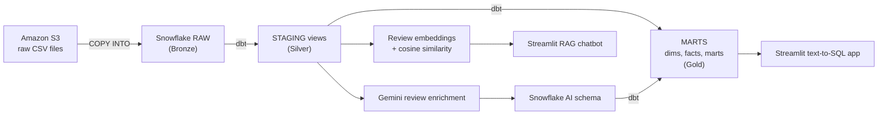
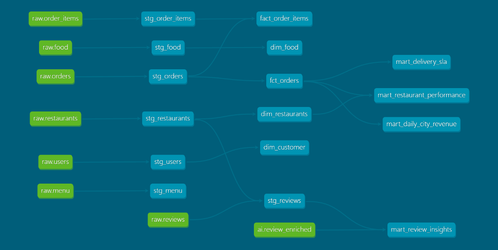
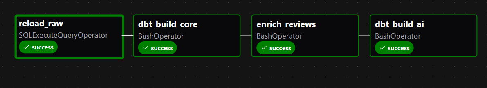

# Food Delivery AI Data Pipeline

An end-to-end data engineering project. It loads food-delivery data from Amazon S3 into Snowflake, models it with dbt using a medallion architecture (RAW → STAGING → MARTS), orchestrates the workflow with Apache Airflow, and adds Gemini-powered apps for review analysis and natural-language analytics.

**Stack:** Amazon S3 · Snowflake · dbt Core · Apache Airflow · Docker · Google Gemini API · Streamlit · Python · SQL

> **Dataset note:** the data is synthetic (the fact tables are generated). It is used to practise pipeline design at realistic scale, not to report on a real company.


## What this project shows

- **Ingestion:** `COPY INTO` from an S3 external stage into Snowflake RAW tables.
- **Modeling:** dbt staging views, dimension tables, incremental fact tables and analytics marts.
- **Orchestration:** an Airflow DAG that runs load, core build, AI enrichment and AI build in order.
- **AI enrichment:** Gemini classifies each review by sentiment, topic and key issue.
- **RAG chatbot:** answers questions about reviews using embeddings and cosine-similarity retrieval.
- **Text-to-SQL:** plain-English questions become validated `SELECT` queries on Snowflake.

## Dataset

| Table | Description | Approx. size |
|---|---|---|
| orders | Core fact: status, amounts, timestamps | ~10M rows |
| order_items | Line items per order | ~23M rows |
| reviews | Free-text comments and ratings | ~300K rows |
| restaurants, users, food, menu | Dimension source files | smaller |

The CSV files are **not in this repo** (too large for Git).
```
s3://<YOUR_BUCKET>/raw/restaurants/
s3://<YOUR_BUCKET>/raw/users/
s3://<YOUR_BUCKET>/raw/food/
s3://<YOUR_BUCKET>/raw/menu/
s3://<YOUR_BUCKET>/raw/orders/
s3://<YOUR_BUCKET>/raw/order_items/
s3://<YOUR_BUCKET>/raw/reviews/
```

## Architecture



| Layer | Schema | Contents |
|---|---|---|
| Bronze | `RAW` | Data as loaded from S3, untouched |
| Silver | `STAGING` | Cleaned, typed, renamed views (one per source table) |
| Gold | `MARTS` | Dimensions, incremental facts, analytics marts |
| AI | `AI` | LLM-enriched review results |

## dbt models

| Type | Models |
|---|---|
| Staging views | one per source table (7 total) |
| Dimensions | `dim_restaurants`, `dim_customer`, `dim_food`, `dim_date` |
| Facts (incremental, merge) | `fct_orders`, `fact_order_items` |
| Marts | daily city revenue (GMV, AOV, cancel rate), delivery SLA, restaurant performance |
| AI mart | review insights by city, topic and sentiment |



## Orchestration

The Airflow DAG `food_delivery_batch` runs daily with catchup disabled:



| Task | Purpose |
|---|---|
| `reload_raw` | Runs Snowflake `COPY INTO` to load files from the stage into `FOOD_DELIVERY.RAW` |
| `dbt_build_core` | Builds and tests all dbt models except those tagged `ai` |
| `enrich_reviews` | Runs `ai/enrich_reviews.py` to classify new reviews with Gemini |
| `dbt_build_ai` | Builds dbt models tagged `ai` on top of the enriched data |


## AI features

### 1. Review enrichment

`ai/enrich_reviews.py` reads reviews from Snowflake and asks Gemini for structured output:

- `sentiment_label`: positive, negative or neutral
- `sentiment_score`: -1.0 to 1.0
- `topic`: food quality, delivery, pricing, service, packaging or other
- `key_issue`: short description of the main problem

Results are stored in `FOOD_DELIVERY.AI.REVIEW_ENRICHED` and joined with staged reviews in a dbt model.

The script processes a **small sample** by default to stay within API quota. Change the sample size in the script's configuration before running larger volumes.

### 2. RAG chatbot over reviews

1. Read a sample of reviews from Snowflake.
2. Create embeddings for the review text.
3. Cache the embeddings in a Parquet file.
4. Embed the user's question.
5. Rank reviews by cosine similarity and take the top matches.
6. Send the question and the matches to Gemini for a grounded answer.
7. Show the answer and the source reviews in Streamlit.

Use the same embedding model for stored reviews and for questions. If you change the model, delete the cache and regenerate it.

### 3. Natural language to SQL

`ai/text_to_sql.py` turns questions into Snowflake SQL using a description of the MARTS schema. The app checks that the query is a read-only `SELECT`, runs it, and shows the table and SQL.

Example questions:

- Top 10 cities by GMV
- Which cuisine has the most orders?
- Average delivery time by city, worst first
- Cancellation rate by payment method

The SELECT check is a basic safeguard, not a security boundary. Run the app with a dedicated read-only Snowflake role (see Security).

## Setup

### Prerequisites

- Docker Desktop
- A Snowflake account
- An AWS account and an S3 bucket with the source files
- A Google Gemini API key
- Python 3.10+ and Git

### 1. Create the AWS and Snowflake objects

Run the SQL in `infra/snowflake/` in order:

| File | What it does |
|---|---|
| `01_setup.sql` | Warehouse, database, schemas, `DBT_ROLE` |
| `02_storage_integration.sql` | Storage integration to S3  |
| `03_stage_and_formats.sql` | CSV file format and external stage |
| `04_raw_tables.sql` | RAW tables |
| `05_copy_into.sql` | Loads RAW from S3 |

Connecting Snowflake to S3 with a storage integration:

1. Create an IAM role in AWS with a read-only S3 policy (`infra/aws/`).
2. Run `CREATE STORAGE INTEGRATION` with that role's ARN.
3. Run `DESC INTEGRATION <name>` and copy `STORAGE_AWS_IAM_USER_ARN` and `STORAGE_AWS_EXTERNAL_ID`.
4. Paste both into the role's **Trust relationships** policy.
5. Check with `LIST @<stage>`.

> Do not use `CREATE OR REPLACE` on the integration. It generates a new external ID and breaks the trust policy.

### 2. Configure environment variables

Copy `.env.example` to `.env` and fill it in. Never commit `.env`.

```dotenv
# Snowflake
SNOWFLAKE_ACCOUNT=your_account_identifier
SNOWFLAKE_USER=your_username
SNOWFLAKE_PASSWORD=your_password
SNOWFLAKE_ROLE=DBT_ROLE
SNOWFLAKE_WAREHOUSE=FOOD_DELIVERY_WH
SNOWFLAKE_DATABASE=FOOD_DELIVERY

# Gemini
GEMINI_API_KEY=your_gemini_api_key
```

### 3. Run dbt

Use a separate virtual environment for dbt so its packages do not conflict with Streamlit or Airflow.

```bash
python -m venv .venv-dbt
.venv-dbt\Scripts\activate        # Windows
pip install dbt-snowflake
cd food_delivery
dbt debug
dbt build
```

### 4. Run Airflow

```bash
cd airflow
docker compose up -d --build
```

Open `http://localhost:8080`, enable the `food_delivery_batch` DAG and trigger a run. Use the admin login set in your `.env`.

### 5. Run the Streamlit apps

```bash
python -m venv .venv-app
.venv-app\Scripts\activate        # Windows
streamlit run ai/text_to_sql.py
streamlit run ai/rag_chat.py
```

## Repository structure

```
.
├── ai/
│   ├── enrich_reviews.py     # Gemini enrichment -> FOOD_DELIVERY.AI.REVIEW_ENRICHED
│   ├── rag_chat.py           # review RAG chatbot (Streamlit)
│   └── text_to_sql.py        # text-to-SQL app (Streamlit)
├── airflow/
│   ├── dags/
│   │   └── food_delivery_batch.py   # the pipeline DAG (4 tasks)
│   ├── Dockerfile            # Airflow image, dbt in its own virtual environment
│   └── docker-compose.yaml   # postgres, api-server, scheduler
├── food_delivery/            # dbt project
│   ├── dbt_project.yml
│   ├── macros/               # custom schema-name macro
│   └── models/
│       ├── staging/          # 7 staging views (Silver) and sources
│       └── marts/            # dimensions, incremental facts, business marts (Gold)
├── infra/                    # Snowflake setup SQL (run in order) and AWS IAM policy templates
├── docs/images/              # screenshots used in this README
├── .env.example
└── .gitignore
```

## Security

- Secrets live in `.env`, which is in `.gitignore`. Only `.env.example` with placeholders is committed.
- S3 access uses an IAM role through a Snowflake storage integration, so no AWS keys are stored in Snowflake. 
- The text-to-SQL app should connect with a read-only role that has `SELECT` on `MARTS` only. Do not run it as `DBT_ROLE` or `ACCOUNTADMIN`.
- Treat LLM-generated SQL and LLM-generated labels as untrusted. Validate them before use.
- Check your Gemini quota and set billing alerts before raising the review sample size.

## Limitations

- Review enrichment runs on a sample, not all reviews.
- Incremental facts filter on order timestamp, so late-arriving rows and later status changes are not picked up.
- Embeddings are cached locally in Parquet. This does not scale to millions of reviews.

## Future improvements

- Incremental RAW loading instead of full reloads
- More dbt tests (uniqueness, not null, relationships)
- Resumable enrichment with retries for API errors
- A dedicated vector store for embeddings
- Deployment, monitoring and cost tracking
- A streaming version with Kafka and Spark

